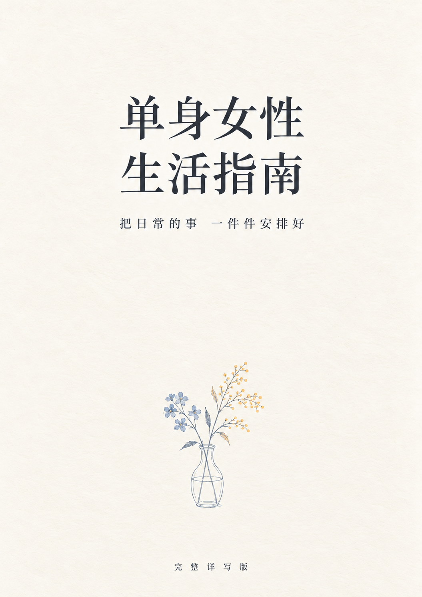

# 单身女性生活指南

**[下载完整 PDF](https://github.com/janiezhang52-lab/single-women-life-guide/releases/download/v1.0.0/single-women-life-guide-v1.0.0.pdf) · [下载可编辑 Word](https://github.com/janiezhang52-lab/single-women-life-guide/releases/download/v1.0.0/single-women-life-guide-v1.0.0.docx) · [在线分章阅读](docs/CONTENTS.md)**

房租怎么核对，生病时怎么安排，忙的时候怎么吃好，关系和未来照护怎样提前商量。这本指南把日常会遇到的事，写成可以一步步照着做的办法。

  

**当前版本 v1.0.0，完整详写版。** 全书 111 页、9 章、95 个小节，另附 8 份填写工具和 69 条资料来源。内容定稿于 2026 年 10 月 17 日，GitHub 首次发布于 2026 年 10 月 20 日。

## 从眼前的一件事开始

不必从第一页读到最后一页。准备签租约，就先看住房；收入可能中断，就先核对付款日期和现金缺口；要去医院，就先安排资料、陪护与返程。

| 章节 | 可以解决什么问题 |
| --- | --- |
| [01 住得安心](docs/chapters/01-housing.md) | 看房、核验出租权、改合同、报修、退租与押金争议 |
| [02 收入撑得住生活](docs/chapters/02-money.md) | 必要支出、收入波动、医保接续、换工作、债务与保险 |
| [03 生病时有安排](docs/chapters/03-medical.md) | 就诊准备、看报告、核对药单、手术住院、出院与急救 |
| [04 身体由自己照顾](docs/chapters/04-health.md) | 筛查、疫苗、性健康、月经、睡眠、身体活动与心理支持 |
| [05 一个人也要吃好](docs/chapters/05-food.md) | 蛋白质搭配、采购分装、八份食谱、外卖与食物保存 |
| [06 工作中的权益](docs/chapters/06-work.md) | 面试、劳动合同、工资社保、加班、骚扰、离职与欠薪 |
| [07 关系与支持](docs/chapters/07-relationships.md) | 家庭边界、约会、同居、数字隐私、分手安全与求助 |
| [08 未来有人照护](docs/chapters/08-care.md) | 照护分工、委托与监护、养老服务、预付费、遗嘱与资料 |
| [09 日子过得有意思](docs/chapters/09-everyday-life.md) | 精力与时间、兴趣预算、社交、独自旅行、节日和生活节奏 |

[查看全部 95 个小节](docs/CONTENTS.md) · [八份可复制的填写工具](docs/TOOLS.md)

## 写到可以开始行动

每章都有具体场景、判断方法、操作步骤、费用算例和可改写的话术，也写了对方不配合、计划没做成时的下一步。

例如，退租被扣押金时，先把清洁费、维修费与未结水电拆开，逐项核对合同、入住记录和费用依据；收入暂时中断时，先把下一次到账之前的必付款按日期排出来；忙得没力气做饭时，给自己留一套能执行的备用组合。

金额和人物情境用于说明方法，不是市场报价或真实案例。可以先借用书里的字段，再换成自己的情况。

## 适合谁

这本书写给需要自己安排生活的成年女性，以中国大陆一般生活环境为主。你可能一直单身，也可能在离异、丧偶或关系变化后重新开始；可能独居、合住、与家人生活，也可能正在养育孩子。

单身、独居和有无孩子是不同的信息。不要求读者收入宽裕、身体健康，或随时能请家人帮忙。按自己的处境选用内容即可。

## 下载与使用

- **PDF**：适合阅读、检索和打印。目录、小节书签与正文来源链接可以跳转。
- **Word**：保留可编辑正文和表格，可在自己的副本中填写与调整；不同软件打开后的分页可能不同。
- **在线章节**：便于直接读某一节、定位问题和提交纠错；纸面排版以 PDF 为准。

[版本与下载页](https://github.com/janiezhang52-lab/single-women-life-guide/releases/tag/v1.0.0)提供两个完整文件和 [SHA-256 校验值](book/SHA256SUMS.txt)。仓库内也保留 [PDF](book/single-women-life-guide-v1.0.0.pdf) 与 [Word](book/single-women-life-guide-v1.0.0.docx) 副本。

## 使用时了解这些

法律与办事资格需要结合地区、合同和个人情况；健康内容用于准备就医和提出问题，不能替代诊断与治疗。国外医学和食品安全资料在来源中标明机构，不能直接作为中国的办事政策。

食谱的蛋白质按食材数据估算，烹调时间尚未经过厨房实测；份量不是每个人的食量上限。材料中的人物、金额和安排，如无另行说明，均为教学假设。

[资料来源](docs/SOURCES.md)逐条保留支持范围与核实日期，主要为 2026 年 10 月 8 日和 10 月 17 日。发布日不代表重新核验了全部政策。完整说明见[阅读前说明](docs/READING.md)。

## 纠错与补充

欢迎在 [Issues](https://github.com/janiezhang52-lab/single-women-life-guide/issues) 提出错别字、链接失效、算例错误或需要更新的规则。请写明章节、小节或 PDF 页码；涉及政策时附官方原文和适用地区。

请不要上传身份证、病历、合同中的个人信息、账户资料或他人的联系方式。普通反馈可使用[纠错模板](.github/ISSUE_TEMPLATE/correction.md)。版本变化记录在 [CHANGELOG.md](CHANGELOG.md)。

## 作者与制作

由[宁宁](https://github.com/janiezhang52-lab)发起并主导，与 Codex 协作完成内容整理、资料核对和排版。封面使用 OpenAI 图像生成工具制作，正文也有 AI 辅助；AI 参与不等同于专业机构审核。

本指南为独立创作，与所引用机构及《高性价比人生指南》项目没有隶属或背书关系。项目起意受到 [HowToLiveBetter](https://github.com/eternity4719/HowToLiveBetter) 将生活经验整理成可查阅指南的形式启发；本书围绕不同读者和生活场景重新组织内容。

本仓库用于公开阅读和下载，暂未另行授予商业使用、再分发或修改后发布许可。第三方来源与材料的权利仍归各自权利人。详见[使用与权利说明](RIGHTS.md)。
